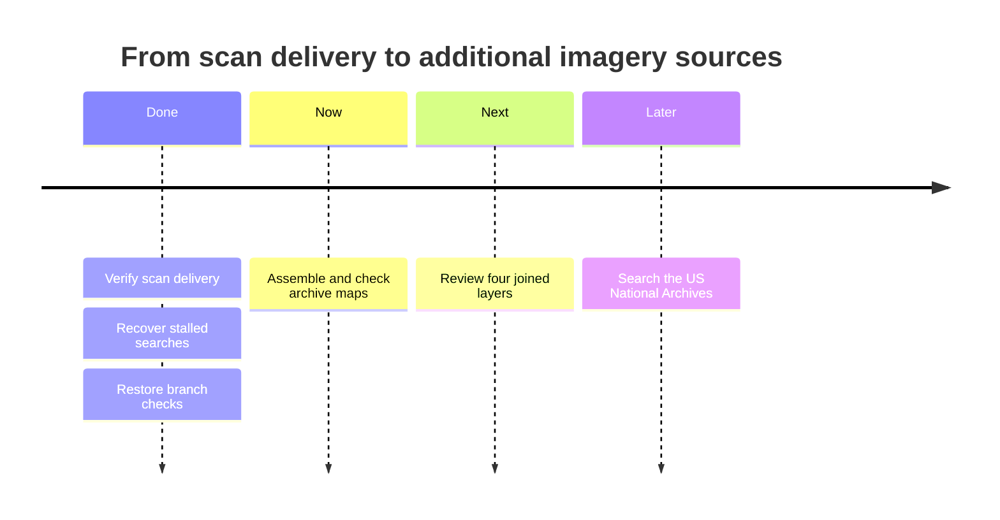

# Historic City Map Maker roadmap

Checked on 27 November 2026 against the map project's Tutti backlog and the [approved delivery plan](docs/research/PLAN.md). The timeline shows priority order. Task IDs open the record in your local Tutti dashboard. From a terminal, use `tutti backlog show t194` with the ID you want.

## Now

- **Assemble the Borroczyn atlas.** The 95 map sheets have been placed at their original resolution. Check the geographic fit at the edges before preparing a replacement for the published layer. [Archive imports · t869](http://127.0.0.1:4777/api/task/t869)

## Next

- **Review four joined layers.** Check the August 1978 and October 1983 aerial joins against the reference map. For the IGA 1911 and cadastral 1974 joins, inspect the sheet borders where the worker could not measure the seams. [Join review · t869](http://127.0.0.1:4777/api/task/t869)

## Later

- 🔵 **Search digitized aerial images from the US National Archives.** Extend the existing manual source with a Setup step for a catalog key and a search for imagery covering the selected city. [t146](http://127.0.0.1:4777/api/task/t146)

## Done

- **Verified the first paid USGS scene.** The order watcher recorded delivery on 17 November, and the import finished that evening. The calibrated layer is published. [Scan verification · t194](http://127.0.0.1:4777/api/task/t194)
- **Recovered timed-out harvests.** The work branch records a timeout on the next search or scheduled harvest check and resumes from the stored dataset checkpoints. [Harvest recovery · t46](http://127.0.0.1:4777/api/task/t46)
- **Verified the branch checks.** The five static checks from the original report pass, along with the full tests and per-file coverage stage. [Static checks · t844](http://127.0.0.1:4777/api/task/t844) · [Tests and coverage · t856](http://127.0.0.1:4777/api/task/t856)
- ✅ **Find and remove cancelled layer versions.** The Imagery screen groups cancelled versions below the live ones. An owner can expand that group and remove a cancelled version. [Group versions · t130](http://127.0.0.1:4777/api/task/t130) · [Remove a version · t131](http://127.0.0.1:4777/api/task/t131)
