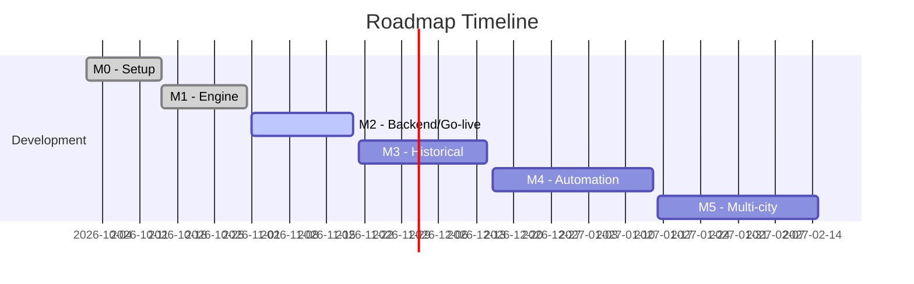

# Roadmap: Historic City Map Maker

This roadmap tracks the development milestones for the Historic City Map Maker engine, admin, and pipeline, as defined in `docs/research/PLAN.md`.

## Status Indicators
- ✅ **Done**: Feature implemented and verified.
- 🚧 **Now**: Currently in active development.
- 🗓️ **Next**: Planned for the next iteration.
- 🏁 **Later**: Future improvements and extensions.

## Now (In Progress)
- [ ] **M2: Backend, Setup Assistant, and Go-live** 🚧 ([M2-interfaces.md](docs/research/M2-interfaces.md))
    - Bootstrap infrastructure, rules, functions, and Admin Setup Assistant.

## Next (Planned)
- [ ] **M3: First Historical Layers and Pipeline** 🗓️ ([M3-interfaces.md](docs/research/M3-interfaces.md))
    - USGS harvest, ranking, import, and Cloud Run pipeline integration.

## Later (Future)
- [ ] **M4: Automation and AI assists** 🏁 ([M4-interfaces.md](docs/research/M4-interfaces.md))
    - Scan buying, automatic GCP suggestions, AI assists.
- [ ] **M5: Multi-city and Starter-kit** 🏁 ([M5-interfaces.md](docs/research/M5-interfaces.md))
    - Engine releases, starter-kit template, static export.

## Done (Completed)
- [x] **M0: Setup, Docker, CI, Agent Assets** ✅ ([M0-handoff.md](docs/research/M0-handoff.md))
- [x] **M1: Engine rewrite and migration** ✅ ([M1-interfaces.md](docs/research/M1-interfaces.md))

## Timeline

