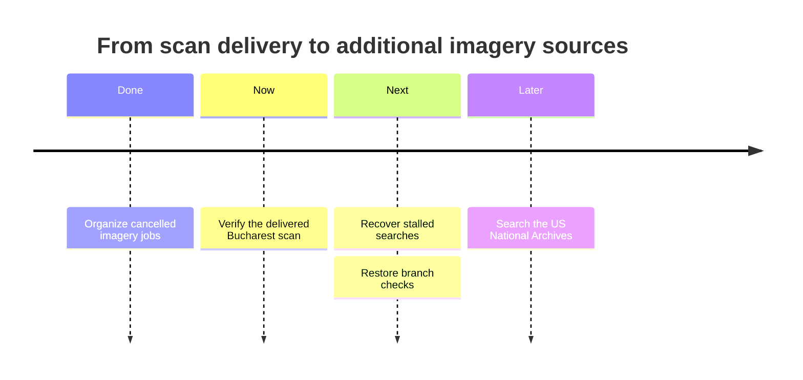

# Historic City Map Maker roadmap

Checked on 27 November 2026 against the map project's Tutti backlog and the [approved delivery plan](docs/research/PLAN.md). The timeline shows priority order. Task IDs open the record in your local Tutti dashboard. From a terminal, use `tutti backlog show t194` with the ID you want.

## Now

- 🔴 **Verify the delivered Bucharest scan.** USGS reported delivery on 16 November. The download window ended on 26 November. Check whether the order watcher imported the scene and whether the scan is available to the map owner. [t194](http://127.0.0.1:4777/api/task/t194)

## Next

- 🟠 **Recover a timed-out imagery search.** A Bucharest harvest kept showing “running” after its worker timed out. The next search or scheduled check should mark the old run as failed and explain why. [t46](http://127.0.0.1:4777/api/task/t46)
- 🟠 **Restore the branch checks.** The static run reported failures in the scenario registry, formatting, stylesheet and dependency checks. The test run reported Vitest and coverage failures on the same revision. [Static checks · t844](http://127.0.0.1:4777/api/task/t844) · [Tests and coverage · t856](http://127.0.0.1:4777/api/task/t856)

## Later

- 🔵 **Search digitized aerial images from the US National Archives.** Extend the existing manual source with a Setup step for a catalog key and a search for imagery covering the selected city. [t146](http://127.0.0.1:4777/api/task/t146)

## Done

- ✅ **Find and remove cancelled layer versions.** The Imagery screen groups cancelled versions below the live ones. An owner can expand that group and remove a cancelled version. [Group versions · t130](http://127.0.0.1:4777/api/task/t130) · [Remove a version · t131](http://127.0.0.1:4777/api/task/t131)
