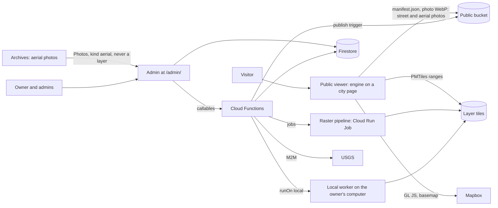
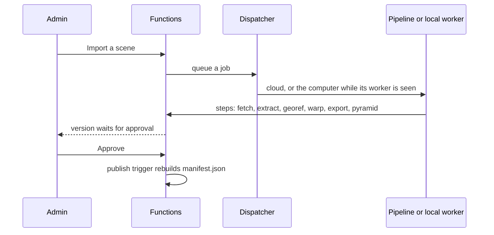

# Architecture

**Historic City Map Maker** is a data-driven historical map engine plus a "do-everything" admin for any city. Example: **București dispărut** (Bucharest, <https://bucurestiul-disparut.web.app/>), the first map made with it. This document is the concise architecture; the approved plan and its reasoning are in [research/PLAN.md](research/PLAN.md), the security and cost review in [research/design-review-security-cost.md](research/design-review-security-cost.md), the testability review in [research/design-review-testability.md](research/design-review-testability.md), and what M0 actually built in [research/M0-handoff.md](research/M0-handoff.md).

## Overview

```text
            ┌──────────────── this repo (npm workspaces monorepo) ─────────────────┐
 tag vX ───►│ packages/engine → dist/engine.* → cdn/engine/ + release.json ──► jsDelivr @vX.Y.Z (SRI) / @1
            │ packages/admin  → dist/admin.*  ──► Firebase Hosting <proj>.web.app/admin/ (M6: the admin's folder)
            │ packages/{shared,ui,test-support}                                       │
            │ sites/<city>/ (config.js + site.json → generated index.html; engine same-origin)
            │   → dist/site/<city>/ → dist/pages/ (Bucharest at /, every other city at /<city>/) ──► GitHub Pages (optional, M6)
            │   → npm run build:hosting → dist/hosting/ (M6: the public map at /, the cities, /city/, /admin/) ──► Firebase Hosting
            │ starter-kit/ (the M1 kit the site build makes)  templates/starter-kit/ (M5: 3 files, engine from jsDelivr)
            │ packages/create-historic-city (M5: npm create historic-city: the kit, and self-host from the owner's CLIs)
            │ functions/ (Firebase Functions v2, TS, Node 24) ──► us-central1         │
            │ pipeline/ (Python + GDAL container) ──► Cloud Run Jobs                  │
            │ firebase/ (rules, indexes, firebase.json)  infra/ (bootstrap, doctor)   │
            └─────────────────────────────────────────────────────────────────────────┘
 Public viewer ─GET→ gs://<proj>-public/cities/{city}/manifest.json + photo WebP (no Firestore, no Firebase SDK for data)
 Admin ─Auth/Firestore/Storage(private)/callables→ Functions → Secret Manager · USGS M2M · Mapbox APIs · Cloud Run Admin (REST)
 jobs doc ─trigger→ Cloud Run Job (GDAL) → GCS COG/preview → [admin approves + CU guard] → Mapbox MTS → layer published → manifest rebuilt
```

| Workspace | Package | Status |
| --- | --- | --- |
| `packages/shared` | `@hcm/shared`: zod schemas (City Manifest v1 with POIs, embed config, every Firestore document and path, the fields clients may write), the backend API (callable and HTTPS request/response schemas, the function registry, error codes with RO/EN messages), validation with localized codes, geo helpers and POI geometries, the overlay model and its Mapbox paint mapping, the URL-hash codec, the Markdown subset, text redaction, the legacy migration, i18n catalogues, logging with redaction | M1 contracts done (with PLAN Addendum 3); M2 backend contracts done |
| Start page (M14) | `packages/admin/src/start/`, `packages/ui/src/start/`, `scripts/site/src/start/` | A new owner's first Hosting release from a browser, no Firebase SDK, on a Hosting site of its own (`docs/research/M14-start-your-map.md`) |
| `packages/ui` | `@hcm/ui`: Lit 3 Material 3 Expressive kit (19 elements), theme and dynamic colour (`themeFromSeed`, `applyTheme`), window classes, self-hosted fonts, the map shared by both apps (`packages/ui/src/map/`, entry `@hcm/ui/map`: `MapPort`, the Mapbox adapter and its helpers, the lazy Mapbox GL loader; `@hcm/ui/map/draw`: `MapDrawPort`, the Terra Draw tools and their lazy loader), the viewer's elements (`packages/ui/src/viewer/`) and the admin's (`packages/ui/src/admin/`, entry `@hcm/ui/admin`: the shell, Setup, the editing kit and one folder per editor area; `@hcm/ui/admin/areas/<area>`: each area's page and definer, the admin's lazy chunks) | M1 done; admin elements M2b; the editors M2c |
| `packages/engine` | `@hcm/engine`: the public viewer, global `window.HistoricCityMap`: configuration, the viewer store, the MapPort and its Mapbox adapter, consent-gated telemetry, `mount` and the auto-boot | M1 done (the built Bucharest site passes the e2e smoke, functional matrix, a11y specials and no-WebGL tiers; since 2026-10-17 the tour's generic layout and accessibility checkers report open findings, listed in `docs/research/layout-a11y-findings.md`) |
| `packages/admin` | `@hcm/admin`: the admin's DOM-free logic: boot, auth state machine, Google consent port, routes and page registry, Firebase adapters, telemetry, the Setup Assistant's controller, the Google REST clients, the provisioner and the legacy import; the editors' content seam (`src/content/`) and one store per area (`photos`, `pois`, `layers`, `settings`, `admins`, `history`, `jobs`, `crashes`, `home`), the admin map's factory and live preview (`src/map/`); builds the ES module `dist/admin.mjs` that the page loads as a module script, each editor area (`src/pages/<area>.ts`) and Terra Draw a lazy chunk loaded when first needed, a page whose chunk fails offering Try again (`DECISIONS-for-review.md` §34b; `build:e2e`: the emulators, the OAuth stand-in and the `?city=` override); once Setup is complete an empty address opens the dashboard (§34i) | M2b done; M2c: every editor wired into the shell, and what it saves reaches the viewer (the A41 journeys on the emulators); M3: the Imagery area, the georeferencer and the layer editor's Replace, Edit points and Crop, each a lazy chunk (`imagery`, `georef`, `layer-geometry`) |
| `packages/test-support` | `@hcm/test-support`: `FakeMap` and a fake `mapboxgl` (`@hcm/test-support/fake-map`), `FakeMapDraw`, `FakeContentStore` (`@hcm/test-support/fake-content-store`), axe (`@hcm/test-support/axe`), recording log sinks; msw handlers later (test-only) | M1; M2c fakes |
| `functions/` | `@hcm/functions`: thin v2 triggers over pure handlers and ports, the composition root, the deploy artifact `functions/dist/` | M2 backend done: the 35 functions of the registry (`setup.createCity` joined in M2b; `layers.delete` and `layers.link` in M2c), wired and tested under the emulators |
| `firebase/rules-tests/` | `@hcm/rules-tests`: allow and deny matrix, field rules, limits and indexes under the emulators, plus `firebase.json` and `.firebaserc` | running (M2 rules) |
| `e2e/` | `@hcm/e2e` (Playwright 1.64): `e2e/scenarios.json`, the mock APIs (`e2e/mock-apis/`), the fixture manifest, the firewall, console and placeholder guards, the tiers of `e2e/projects.ts`, the tour's state inventory (`e2e/tour/states.ts`) and its generic layout and accessibility checkers (`e2e/support/`, unit-tested in `e2e/test/`) | harness, smoke, the viewer's functional matrix, the tour, the a11y specials and no-WebGL running; the admin tier (harness, the owner's smoke, the whole Setup Assistant journey, every editor area and the admin-to-viewer journeys, at five projects) running; the M3 imagery specs (`e2e/admin/specs/imagery/`: search, import, upload, the georeferencer, publishing and the guard, the Link dialog's Check, crop, replace, re-georeference, raster jobs, and the real pipeline in `pipeline.spec.ts`); swipe compare (M4) planned |
| `pipeline/` | `pipeline/src/hcm_pipeline` (Python + GDAL, Poetry) | M3: every step of `python -m hcm_pipeline run` (fetch to register), tested against loopback fakes and synthetic scenes of known transform, and once under the admin tier against the emulators (contract: [research/M3-interfaces.md](research/M3-interfaces.md) §5, golden documents in `pipeline/tests/contracts/`) |

Layering (enforced by dependency-cruiser): `shared` below `ui` below `engine` and `admin`; engine and admin are independent; `shared` imports no DOM, Lit or Mapbox; only `packages/ui/src/map/mapbox-adapter.ts` touches Mapbox GL, and it reads the page's global `mapboxgl` through a structural type instead of importing `mapbox-gl`. Because `ui` cannot import the engine, the viewer elements in `packages/ui/src/viewer/` drive the engine's store through a mirrored port (`store-port.ts`).

## Why this shape

- **Server-side calls are required**: USGS M2M allows no CORS outside `*.usgs.gov`, and secrets must stay on the server.
- **Cloud Run, not GitHub Actions, for GDAL work**: Actions logs are public and would leak signed USGS URLs; no GitHub token or service-account key is needed anywhere.
- **The public site never reads Firestore**: no read quota, no abuse surface, no Firebase SDK for data.
- **One Firebase Hosting origin for the public map and the admin** (M6, [research/M6-interfaces.md](research/M6-interfaces.md) §2): `<proj>.web.app` serves the viewer at its root and the admin under `/admin/`; the admin's CSP is a header on `/admin/**` only and every viewer page keeps its own meta policy, so no page has two; their storage never collides (`hcm:<cityId>:*` beside `hcm:admin:*`, the admin's GA4 cookies prefixed `hcm_admin`; `admin` and `city` are reserved city ids). Before M6 the admin had this origin alone because `ventura8.github.io` is shared by every Pages site of the account; GitHub Pages is optional now (a redirect tree can replace the old site). **Since 2026-11-13 the admin has its own site** ([research/DECISIONS-for-review.md](research/DECISIONS-for-review.md) §210): `<proj>-admin.web.app/admin/`, made by Provision's `admin-site` item and released beside the public map by the site build's `hosting` step; the public map's `/admin/…` answers 301 there (the hash route kept); a project without that site keeps the admin under `/admin/` of the map's origin.
- **Region**: Firestore `nam5`, everything else `us-central1`, where the free tiers apply and triggers stay in-region.

## Diagrams





## Engine (public viewer)

The public contract (config.js, `<hcm-map-viewer>`, the JavaScript API, the URL hash, the City Manifest v1, versioning) is [ENGINE_API.md](ENGINE_API.md); the M1 module interfaces and ownership are in [research/M1-interfaces.md](research/M1-interfaces.md).

- A city page ships `index.html` and `config.js` (`window.HistoricCityMapConfig = {cityId?, manifestUrl? | manifest?, container?, lang?, engineBase?}`; the inline manifest is the starter kit's static mode). The engine fetches only the static manifest and photo WebP files from the public bucket.
- Mapbox GL JS **3.34.1** is loaded from `api.mapbox.com` as the global `mapboxgl` and never bundled; Standard Satellite basemap; historical rasters in the `middle` slot; `performanceMetricsCollection: false`; the Mapbox logo and attribution are always visible where the map is: the modal sheets, the lightbox and the dialogs draw above Mapbox's controls, which move into the part of the map a modal sheet leaves in view (above a bottom sheet's top edge, beside a side sheet; `packages/ui/src/viewer/legal-lift.ts`, `viewer-legal.ts`; scenario V18); the lightbox and a full-screen dialog hide the whole map, so nothing there needs a credit (the Pixel 9 Pro review, 2026-11-12, P3, replaced the legal bar and About's copy, which took the foot of every surface on a phone; DECISIONS-for-review.md §174).
- The core (state, URL hash, timeline, controller) talks only to a `MapPort`; the Mapbox adapter is the only Mapbox-aware module. **One map per view**: swipe compare creates its second map lazily and destroys it (a compact window hides it for a minute first, so turning a phone back reuses it).
- Features: timeline (a city without historical layers shows a "coming soon" note instead), photos as clustered camera icons rotated by bearing with view cones, bottom or side sheet, a full-size view with Zoom in and Zoom out, About and the map's menu (right click or long press: Open in Google Street View, Copy coordinates; `ENGINE_API.md` → *The map's menu*), all three side-loaded with their Subresource Integrity the first time one opens (`engine.extras.js`, `ENGINE_API.md` → *Side-loaded parts*), a photo's improved and colorized versions with a switch Original / Improved / Colorized (`ENGINE_API.md` → *Photo versions*; `photos.onUpload` makes their WebP pairs from an upload whose metadata names the version, the manifest lists them under `versions`), the zoom buttons and a compass whose press turns the map north up and level (`ENGINE_API.md` → *Compass*), URL state and share, Show my location (a blue dot that follows the visitor while on, `ENGINE_API.md` → *Show my location*), About and credits, 25 languages (each fetched beside the engine when first shown, a text a language still being translated lacks in English, Arabic, Persian and Urdu right to left: `ENGINE_API.md` → *Language*), light/dark/seeded theme.
- The engine build ships next to its script everything it loads at run time: the ES module build's lazy chunks, the languages' texts (`dist/i18n/<locale>.json`), the side-loaded `engine.extras.js`, the IIFE's extras (`extra-<name>-<hash>.js`, each loaded with the integrity the build wrote into the IIFE: `ENGINE_API.md` → *Extras on demand*, `DECISIONS-for-review.md` §219) and the kit's self-hosted fonts (`dist/fonts/`). The page's CSP refuses inline styles, so elements set styles only through the CSSOM.
- Each build also writes `THIRD_PARTY_NOTICES.txt` beside its entry (the engine's, the admin's): every npm package it bundles and every package a font comes from, with the version, the licence and its text (`scripts/site/src/notices.ts`, a Vite plugin; checked against the build's source maps by the `notices` gate, permissive licences only; `DECISIONS-for-review.md` §52d, §53b). The site build, the GitHub Release and jsDelivr carry the engine's with the engine; Hosting serves the admin's.
- **Overlays** (PLAN Addendum 3): every historical layer, the photos and every POI category is an overlay with a switch and a live opacity slider; opacities persist in the URL hash (`&op=`). The pure overlay model and the paint-property mapping (`raster-opacity`; icon, text, circle, line and fill opacity for vector overlays) live in `@hcm/shared`, so the admin's default-opacity editor uses the same code. Raster image adjustments (brightness range, contrast, saturation) are applied live as Mapbox paint properties, without reprocessing.
- **Aerial photos** (the owner, 2026-11-16; [research/M28-sources.md](research/M28-sources.md)): a photo has a `kind`, `ground` (absent) or `aerial`; an aerial photo is a photo, never a layer: an aeroplane marker on the map, "Aerial photo" in the Photos list, and a Street / Aerial choice in the list when the city has one (`packages/ui/src/viewer/hcm-photo-list.ts`).
- **Points of interest**: city-defined categories (label, Material Symbols icon, colour, default opacity); POIs as icons, lines or fills with labels at high zoom, filtered by the timeline, details in the same sheet as photos.

**Installable app.** Each city site and the admin are installable web apps (`docs/ENGINE_API.md` → *Installable app*): a web app manifest and three PNG icons beside the page, and a service worker that goes to the network first, keeps a copy of the page and its shell only for a visit offline, and never answers the data (`manifest.json`), the release's records (`runtime.json`, `release.json`, `admin.mjs`), another folder or another origin (Mapbox is never cached, as its terms require). The admin's worker is its push worker with lines that keep nothing. Installing is what lets Chrome and Edge on a computer give the device's accent colour (`docs/LESSONS.md` 711). An open page keeps itself up to date (*Installable app* → *Updates*, lesson 718): a city site's script compares its build with `app-build.json` (at start, on focus, on a return, every 15 minutes) and the admin its release with `runtime.json`; a newer one reloads the page at a safe moment (no dialog, compare, drag, unsaved edit or upload; hidden or a minute idle), else a Reload snackbar or banner, and `sessionStorage` remembers what it reloaded for so it never loops.

## Admin

- **Keyboard and gamepad** ([research/viewer-input.md](research/viewer-input.md)): one command set (`packages/ui/src/viewer/input-commands.ts`) behind single-key shortcuts and, in a chunk fetched only once a pad connects, the Gamepad API. The basemap's `lightPreset` follows the theme unless the city's `basemap.config` sets it (`packages/engine/src/core/map-light.ts`). About carries the accessibility statement.
- **Map labels**: the basemap's own street names and points of interest are the visitor's choice too, but no overlay: two switches on Standard's configuration (`docs/ENGINE_API.md` → *Map labels*), offered only when the mounted map has them.
- **Setup Assistant** (first screen until green): Google Cloud billing (Blaze) and budget, Provision cloud, the server's deployment, the owner claim, Mapbox (secret token pasted once, public tokens auto-minted with URL restrictions), USGS (ERS, M2M approval auto-detected by `ops.tick`), Analytics and crash reporting, the legacy Bucharest import. Every human step happens inside the app through verified deep links; the whole assistant takes about ten in-app inputs and four Google consents.
- **Bootstrap mode** (before Blaze, [research/M2b-interfaces.md](research/M2b-interfaces.md) §3): sign-in, ownership, billing, provisioning and the deployment check run with no deployed function and no Firestore access, calling Google's REST APIs from the browser with the owner's own OAuth token (each scope asked when its step runs, kept in memory for at most an hour); the steps' results wait in `sessionStorage` (never a token). As soon as every function is deployed and the server answers, the app claims the map for the owner without a click, creates the city (`setup.createCity`, from the bundled seed), records the start-up results (`setup.recordCloud`) and switches to normal mode. The owner's Firebase sign-in lives in the origin's IndexedDB on the admin's own site (`runtime.json`'s `adminOrigin` naming the page's origin: one sign-in for every tab, kept when the browser closes; §210), and in the tab's `sessionStorage` anywhere else (`browserSessionPersistence`: under the public map's `/admin/` the map shares the admin's origin, whose IndexedDB and `localStorage` every viewer page can read: [research/DECISIONS-for-review.md](research/DECISIONS-for-review.md) §73a).
- **Boot**: Hosting's `/__/firebase/init.json` (never committed; a bad one shows the configuration screen), `runtime.json` beside the page (`/admin/runtime.json` since M6, the Vite build's base `/admin/`: the release, `<version>+<short commit>`, which the boot log and every crash report name; `startUp` for a new map's Hosting-only deploy; later the App Check site key) and `project.json` beside it (a copy of `infra/project.json`: the project the provisioner may touch; without it Setup is unavailable). The site build writes `index.html` (naming the Subresource Integrity digest of the pinned `mapbox-gl.js`, which the first admin map loads from api.mapbox.com with it), `runtime.json`, `project.json`, the kit's fonts and the legacy bundle (`legacy/bucharest/`: the city, 45 photo records, the originals) next to the Vite build (`npm run build:admin`, also Hosting's `predeploy`). Before the server is installed the admin probes `admin-session` anonymously, unless `runtime.json` says `startUp`: then nothing of the server is called before Google shows every function installed (step d), so the browser logs no CORS error (`HCM_ADMIN_START_UP=1 npx firebase deploy --only hosting` for that first deploy, `DECISIONS-for-review.md` §36b).
- **Shape**: DOM-free logic in `packages/admin` (`mount()` with injected ports, tested in Node: the auth controller, the Setup controller with one flow per step over the `SetupCloud`, backend and import ports, the typed Google REST clients over `fetch` and the provisioner of `PROVISION_ITEMS`), the Lit elements in `packages/ui/src/admin/` (navigation bar on compact windows, a rail from medium, the expanded rail from large; the Setup page as one column or list and detail), structural ports between them (`admin-port.ts`, `setup-port.ts`, pinned by a type test), hash routes and a lazy page registry, texts in two admin catalogues of `@hcm/shared` that the viewer never imports. Only `packages/admin/src/firebase/` imports the Firebase SDK.
- **The editors** (M2c, [research/M2c-interfaces.md](research/M2c-interfaces.md)): the dashboard (`#/home`), photos (batch upload with EXIF and file-name prefill, sticky author, source and licence, the last pin, bearing by clicking what the camera looked at, replace, bulk actions, published on save), places (points, lines and areas drawn on the map or typed in the list of positions, GeoJSON import and export), historical layers (order, default opacity, shown at start, image adjustments previewed live, link a tileset or XYZ through `layers.link`, delete through `layers.delete` with a seven-day grace for the tileset), settings (area, texts, theme, POI categories, default opacities), history (revert and restore through `history.revert`), jobs, admins and crash reports. Each area is a DOM-free store (`packages/admin/src/<area>/`) created when its page first opens, behind the content seam (`ContentServices`, the `ContentStore` port over Firestore transactions whose version is `updatedAt`, so a save never overwrites another admin's newer change); the Lit pages (`packages/ui/src/admin/<area>/`) read it through `AdminAppPort.content`; the shell asks the open area before leaving an unsaved draft. An admin whose access is removed while an editor holds changes keeps the page and its draft, read-only (every write refused at once), under a banner with Sign out (`DECISIONS-for-review.md` §35e). Every edit is a draft previewed on the page's one map (Settings' seed colour on the whole admin) and written by Save only; numbers commit on every key, as texts do, and say their problem once the field is left; the history triggers keep the previous version and the publish trigger rebuilds the manifest, which the viewer reads (behaviour A41). The admin map is the viewer's (`@hcm/ui/map`), always on the Standard style (never Mapbox Satellite) with the admin's URL-restricted token from `setup/status`; drawing goes through `MapDrawPort` on Terra Draw (`docs/research/DECISIONS-for-review.md` §34g, §41b: a new shape is drawn by clicks, Terra Draw drags a selected shape, a vertex or a midpoint, and a click moves a selected point; the list of positions is the keyboard's way; the click-only tools are the fallback when Terra Draw does not load). On an extra-large window the map sits beside the form as a supporting pane (§41d). Dates are typed in the admin's language (`zz.ll.aaaa`, `dd/mm/yyyy`), never in the browser's date input. Texts: one `admin-*` catalogue folder per area in `@hcm/shared`, merged by `translateAdminContent`; Romanian and English bundled, the interface's 23 other languages fetched as `/admin/i18n/<locale>.json` when chosen, a missing key in English ([I18N.md](I18N.md)).
- **Historical imagery** (M3, [research/M3-interfaces.md](research/M3-interfaces.md) §10): the Imagery area (`#/imagery`: the scenes the server harvested from USGS, ranked with their reasons, filters and footprints on the area's one map; **Import** on a free scene's card is the one input of the happy path; a version's page follows its job live, with the approval card, the compute-unit guard's three ways out and the free Studio steps; a budget pause's banner with the spend and Resume processing, on Imagery and Jobs; Upload a GeoTIFF with the Storage SDK's resumable upload, a replacement for a layer at `#/imagery/replace/<layer>`), the georeferencer (`#/georef/<version>`: the scan beside the reference map, OpenStreetMap or Sentinel-2 and never Mapbox Satellite, the pairs with their residuals, the fit computed in the page by `packages/shared/src/georef/` and held to the pipeline's golden cases, a warped preview as a canvas source because the CSP refuses `blob:`), and the layer editor's Replace the image, Edit points and Crop (the `layer-geometry` chunk, drawn through `MapDrawPort`). Each is a lazy chunk with its own gzip budget (`imagery` 18 KB, `georef` 18 KB since §110 with its lazy `georef-extras` 2 KB, `layer-geometry` 3 KB; `DECISIONS-for-review.md` §47a). The Jobs page names a raster job's steps and its wait, with Run it again and the georeferencer link; Settings has the imagery section; Home counts versions to approve and scans waiting for points. M4 ([research/M4-interfaces.md](research/M4-interfaces.md) §1, §2): buying a scan is the order card on a scene USGS has not scanned (its cost, the scene's verified EarthExplorer page, **I ordered it**: `usgs.markOrdered`, which refuses a scene USGS already offers; a chunk of its own, `order-card`, fetched the first time such a scene opens), then the server's daily watch, reminders and import on delivery; the georeferencer shows the matcher's less sure pairs as suggestions (Accept, Reject, Accept all; nothing saved without Save).
- **Assists and notifications** (M4, [research/M4-interfaces.md](research/M4-interfaces.md) §4, §5): title suggestions in the photo and place editors (`assist.suggestTitle`: a cell of about 11 m cached 90 days, the `assist-geocode` Cloud Tasks queue at one Nominatim request a second for the whole project, a ten-minute cool-down after a refusal, OpenStreetMap's attribution under the suggestions) and translation drafts beside every Romanian and English pair of the photo, place and layer editors (`assist.translateDraft`: the first model of the pinned list `VERTEX_MODEL_IDS` Vertex AI offers the project, `gemini-3.5-flash-lite` then `gemini-3.1-flash-lite`, the choice kept ten minutes per instance, over REST from the functions only (DECISIONS-for-review.md §67g), the month's cap in one transaction, the budget guard, the answer sanitized to plain text within its field's length); both only fill the editor's draft, and only Save writes. What happens (a failed job, a version waiting for approval or points, USGS approval, orders, the budget pause, a crash spike) becomes one event (`notificationEvents/{id}`, `functions/src/api/notification-event.ts`), which `notify.onEvent` fans out to every admin's inbox (`#/inbox`, the unread count on the navigation's Notifications item) and pushes, for the kinds an admin chose, to their browsers through FCM HTTP v1 (the browser's Firebase installation ID, registered after the browser's own permission prompt; the admin's plain service worker shows it as text). No e-mail (DECISIONS-for-review.md §54i).
- **Many cities** (M5, [research/M5-interfaces.md](research/M5-interfaces.md) §1): the city switcher (the top bar's menu from the medium window class, the account menu on a phone; switching is a page load into `#/c/<city>/home`, so no listener of another city survives), **New city** (a lazy chunk `cities`: the name, one rectangle dragged on the map, Create; the first USGS harvest at the next tick), Settings → **Publishing** (the switch that makes a city public, §63a of the decisions log), per-city roles on Admins, Settings → **The city's budget** (chunk `city-budget`) and **Export the city** (chunk `export-card`: Export, Download).
- User guide: [ADMIN_GUIDE.en.md](ADMIN_GUIDE.en.md) (English only, like all of the project's Markdown).

## UI

Lit 3 custom elements with the `hcm-` prefix and no decorators; every Material 3 Expressive component is our own Lit element built on Google's token values (no `@m3e/web` or `@material/web` runtime: why in [packages/ui/README.md](../packages/ui/README.md) → *Decisions*); colour tokens generated from the city seed with `@material/material-color-utilities` (light, dark, high contrast) when the manifest is built, so the viewer applies the manifest's tokens and ships no colour library (a precomputed baseline theme covers loading and errors); window classes measured on the host element (compact below 600, medium, expanded, large, extra-large from 1600, compact height below 480); 48 dp touch targets; self-hosted Roboto Flex and Material Symbols; reduced motion honoured.

## Data

Firestore (zod schemas in `@hcm/shared` are reused by every writer):

- `cities/{city}`: names and About (`{ro, en}`), centre, zoom, bounds, credits, theme seed and tokens, basemap, Mapbox user and public token (automatic), the photos overlay's default opacity, published flag.
- `cities/{city}/layers/{id}`: year and date, label, kind, sensor, attribution, source (`mapbox`, `xyz`, `pmtiles`, zoom range, bounds), order, opacity, image adjustments, status, provenance (USGS ids, georeferencing method, GCPs, checkpoint RMSE), Mapbox tileset id.
- `cities/{city}/photos/{id}`: title and description (`{ro, en}`), year range, author, licence (enum), rights holder, structured `links`, location, bearing, FOV, image (web, thumb, sha256, size), processing state, published flag, rights review, legacy id.
- `cities/{city}/poiCategories/{id}` (label, icon, colour, default opacity, order) and `cities/{city}/pois/{id}` (category, geometry without nested arrays, title and description, year span, links, photo ids, published flag); the manifest carries them as `poiCategories[]` and `pois[]` with GeoJSON geometries.
- Every admin-editable document (city, layer, photo, POI, POI category) carries `updatedBy` and `updatedAt` and keeps a `history` subcollection with the previous version of each change, written by a server trigger, for one-click revert.
- M5 ([research/M5-interfaces.md](research/M5-interfaces.md) §1.2, §1.8, §5.3): `admins/{uid}.cities` (each city the admin belongs to, with the role `owner` or `editor`; written by the functions only, read by the rules with one `get`; a document without it is from before M5 and is migrated, so `admin.claim` writes a new owner's as `{}`, `docs/LESSONS.md` 258), `cities/{city}.limits` (the city's share of the project's budgets) counted in `cities/{city}/usage/{month}`, and `cities/{city}/exports/{id}` (a static export's record; its zip in the private bucket's `exports/<city>/`, deleted after seven days).
- Also `usgsScenes/{entityId}`, `jobs/{id}` with logs, `admins/{uid}`, `invites/{sha256 of the address}` (never the address), `setup/status` (non-secret health of billing, provisioning, Mapbox, USGS, analytics and crash reports), `setup/owner` (the owner's uid), `usage/mapbox-YYYY-MM`, `ops/guard` (with the alert's spend and the admin's resume), `ops/dispatch` (the Cloud Run executions running), `ops/harvest-{city}` (the last USGS harvest attempt and when the next is due), `manifests/{city}` (manifest builds), `countrySources/{country}` (M28: where a country keeps its old maps and images, written by `ops.tick`, read by staff). Every document carries `updatedBy` and `updatedAt`; the fields a client may write are one table, `CLIENT_WRITES`, which the rules mirror. Contracts: [research/M2-interfaces.md](research/M2-interfaces.md) §2.

The Bucharest seed manifest (`seed/bucharest/manifest.static.json`, with WebP derivatives in `seed/bucharest/derived/`) is produced from the legacy data by `scripts/seed/migrate-legacy.mjs` (`npm run seed:migrate`), whose rules are pure functions in `packages/shared/src/migration/`. The old site's 2023 additions live beside it in `seed/bucharest-2023/` (made with `--joins seed/bucharest`, so no id repeats one of the 45) and reach a live project through Setup's legacy import, which bundles both folders (`docs/research/M5-interfaces.md` §12).

Storage: a **private** bucket (`<proj>.firebasestorage.app`: uploads, rasters, USGS raw files, browse copies) and a **public** bucket (`<proj>-public`: manifest, `web.webp`, `thumb.webp`, content-hashed and immutable, and each city's tab icon at fixed names). Legacy HTML is migrated to structured `links`; **no HTML is ever rendered from data**.

The city's tab icon (the owner, 2026-11-08): `cities/{city}.icon` records it (server-owned: `source` `default` or `custom`, the default's `seedColor`, the 180 px file's address and the source's SHA-256), its files are `cities/<city>/icon-32.png`, `icon-180.png` and `icon-512.png` in the public bucket (five-minute cache, overwritten in place). `cities.setIcon` writes an editor's upload (PNG or WebP only, checked from its bytes; never SVG) or the default again; the manifest's build (`publish/icon.ts`) draws the default, the Layers panel's map glyph in the city's seed colour, for a city without one or whose colour changed. The city pages link those fixed addresses (the generic city page once the file loads), so a new icon needs no deploy and the viewer still reads nothing but the bucket; every other page inlines the default. An icon-only write is neither a manifest field nor listed in the city's history. [ENGINE_API.md](ENGINE_API.md) → *The page's tab icon*. Since 2026-11-12 the default wears the user's theme (`ENGINE_API.md` → *The page's tab icon*): every page inlines it in the light and the dark palette's colours and its own script (`tab-icon.js`, no engine byte) redraws it in the chosen theme; an upload has a copy `icon-own-32.png`, the only file a page shows in the tab, never recoloured.

## Cloud Functions

Firebase Functions v2 (Node 24, `us-central1`), one codebase deployed from `functions/dist/`. Every function is one row of the registry in `@hcm/shared` (`CALLABLES`, `HTTP_ENDPOINTS`, `BACKGROUND_FUNCTIONS`: its access rule, App Check mode, instance cap and request/response schemas); every failure reaches the admin as an error code with Romanian and English messages. Contracts, ports and ownership: [research/M2-interfaces.md](research/M2-interfaces.md).

| Group (deployed as `<group>-<name>`) | Functions | Trigger | Runs as |
| --- | --- | --- | --- |
| `admin` | `session`, `claim` (the owner proves ownership with Resource Manager and their own OAuth token), `join` (an invitation for the caller's address) | callable, any verified Google account | `fn-admin@` |
| `admins` | `invite` (stores only the SHA-256 of the address), `revoke` (never the owner or oneself), `list` | callable, admins | `fn-admin@` |
| `history` | `onCityWrite`, `onLayerWrite`, `onPhotoWrite`, `onPoiWrite`, `onPoiCategoryWrite`, `onStoryWrite` (M17) (the previous version of every audited change, newest 50 kept); `revert` | Firestore; callable | `fn-events@`; `fn-admin@` |
| `setup` | `status`, `selfTest`, `recordCloud`, `createCity` (the city from the bundled seed, once, right after the owner claim), `saveMapbox`, `saveUsgs`, `rotatePublicToken`, `analyticsConfig` | callable, admins | `fn-admin@` |
| `telemetry` | `reportError` (the public crash endpoint: origin-checked, 16 KiB, rate-limited, redacted, one structured log entry for Cloud Error Reporting); `listGroups` | HTTPS; callable | `fn-crash@` (no project role); `fn-admin@` |
| `publish` | `on…Write` (six diff-gated triggers, M17's `onStoryWrite` among them that request a build), `buildManifest` (one at a time, debounced per minute, full build), `rebuildManifest` | Firestore; task queue; callable | `fn-events@`; `fn-events@`; `fn-admin@` |
| `photos` | `onUpload` (magic bytes, header-only size check, SHA-256 duplicates, WebP 2048 and 400 px without metadata, the 400 from the 2048, EXIF suggestions; 1 GiB, one upload at a time), `reprocess` | Storage finalize on the private bucket; callable | `fn-events@`; `fn-admin@` |
| `ops` | `tick` (every 15 min: guard, nightly rebuild and public-file sweep, Mapbox and USGS health, token retirement, expired invitations, stale accounts), `onBudget` (turns `ops/guard` red with the spend; the admin's `imagery.resumeGuard` turns it green for that budget period), `onProbe` (M6: answers the nonce `setup.selfTest` writes to `ops/probe`, so the self-test's `events` check sees Eventarc deliver an event as the functions' account, finding 17); since M6 `tick` also re-mints a city's viewer token when the server's viewer origins change; since M28 it researches and refreshes each city's country list (`countrySources/{country}`) | schedule; Pub/Sub `budget`; Firestore | `fn-admin@` (`research/DECISIONS-for-review.md` §19b); `fn-events@` |
| `imagery` (M3) | `search` (the USGS harvest and ranking, 300 s), `browse` (a scene's browse image copied into our bucket), `import`, `approve`, `reject`, `choose` (Studio, next month or pay), `studioDone`, `saveGcps`, `crop`, `retry`, `probeTiles` (one tile of a source, behind the address guard), `resumeGuard` (the budget pause's way out, behaviour A43); `onJobWrite` (the dispatcher: one Cloud Run execution per queued pipeline job, the clean-up of a cancel), `onRasterUpload` (a GeoTIFF upload becomes its job), `publish` (the compute-unit guard with its reservation, the MTS upload, publish, poll, smoke test and finalize; one at a time), `tick` (every 15 min: resume, re-dispatch lost and out-of-memory runs, poll Mapbox, deferred publishes, due layer deletions, the monthly harvest) | callable, admins; Firestore; Storage finalize; task queue; schedule | `fn-admin@`; `fn-events@` |

- **Shape**: each function file holds its thin trigger and its pure handler, which takes `Pick<Ports, …>`; a feature folder exports its group from a factory (`adminFunctions(getDeps)`, ...), and `functions/src/index.ts` only exports the groups. `functions/src/global-options.ts` sets the defaults (`us-central1`, at most 5 instances, concurrency 80, `fn-events@`) and `runAs(name)`, the service account of each registry name (`RUNTIME_ACCOUNTS`; `fn-admin@` is firebase-tools' shorthand for `fn-admin@<project>.iam.gserviceaccount.com`). Callables keep the registry's caps (2 or 3), the crash endpoint 2, the builder, the tick and the budget handler 1.
- **Composition root** (`functions/src/deps.ts`): `RuntimeConfig` from the environment (`GCLOUD_PROJECT`, the default bucket of `FIREBASE_CONFIG`, `HCM_VIEWER_ORIGINS`, `HCM_OAUTH_CLIENT_IDS`, `HCM_APP_CHECK`; set at deploy from `functions/deploy-env.json`, which the build turns into `functions/dist/.env.<project>`) and one adapter per port, created on the first call: Firestore, Auth, Cloud Storage and Cloud Tasks through firebase-admin; Secret Manager, Resource Manager and tokeninfo, Firebase Management (with Identity Toolkit's Google sign-in client, which `admin.claim` accepts when `HCM_OAUTH_CLIENT_IDS` is unset), Error Reporting, Mapbox and USGS M2M over REST with `fetch` and Application Default Credentials; sharp for images, imported on the first photo so no other function loads libvips at cold start. In the Functions emulator the REST adapters reach only the fake upstreams at `HCM_UPSTREAM_BASE` (anything else fails like a network error), secrets live in their fake Secret Manager (in memory without fakes), the Admin SDK is told the task queue's service account (no metadata server locally) and manifest tasks carry no id, because the Cloud Tasks emulator dispatches at once and would swallow the rest of a debounce window.
- **Secrets** are read at runtime with a five-minute cache that `setup/status.secretsRev` invalidates, so a paste works without a redeploy; a save adds a version and destroys the older ones.
- **Deploy artifact**: `npm run build --workspace @hcm/functions` (`functions/build.mjs`, Vite SSR) bundles the workspace code and its own dependencies (zod) into `functions/dist/index.js`, keeps the functions' npm dependencies (`firebase-admin`, `firebase-functions`, `google-auth-library`, `sharp`) external with their exact pins in `functions/dist/package.json`, then checks that every import left is pinned and that the bundle loads with a deploy manifest on every export. `firebase.json` deploys it (`predeploy` builds it).
- **M4** ([research/M4-interfaces.md](research/M4-interfaces.md)): `usgs` (`markOrdered`, `checkOrder` at most once a minute, `cancelOrder`; callables run as `fn-admin@`) records the order on its scene (`usgsScenes/{entityId}.order`, written by the functions only); the daily watch is a step of `imagery.tick` (no new scheduler: each open order asked once a day, reminders on days 7 and 12, `expired` after 90 days, the import of a delivered scan through M3's `startImport` while the guard is green and today's cap allows). `assist` (`suggestTitle`, `translateDraft`, callables; `geocode`, the `assist-geocode` task queue at one Nominatim request a second) and `notify` (`registerDevice`, `unregisterDevice`, `sendTest`, callables; `onEvent`, the fan-out of `notificationEvents/{id}` to every admin's inbox and devices): the callables run as `fn-admin@`, `geocode` and `onEvent` as `fn-events@`. 61 functions in all.
- **M5** ([research/M5-interfaces.md](research/M5-interfaces.md)): `cities` (`create`, the New city flow's two inputs, and `locate`, which finds the named city with one Nominatim search under the title suggestions' cool-down, the project's owner only; `setLimits`, the city's share of the budgets), `admins.setRole` (callables, as `fn-admin@`), and `export` (`start` and `download`, a city's owners, as `fn-admin@`; `build`, the Cloud Tasks task that streams the zip into the private bucket, as `fn-events@`); every city callable checks the caller's role in the request's `cityId` after validating it (`requireCityRole`), a city's notification events reach that city's members only, and `ops.tick` gains the `memberships` (pre-M5 admins and pending invitations) and `exports` steps. 68 functions in all. The M5 reviews' fixes (`docs/research/DECISIONS-for-review.md` §65): a role change or a removal is one transaction that reads the caller, the target and the city's owners (a city keeps an owner; the project's owner stays an owner of every city they belong to, so no city is left to the console); `layers.link` refuses a pipeline tileset (`hcm-<city>-<layer>`) that no layer of the request's city records; `export.download` signs an export at most ten times a UTC day and never while the budget guard is red. One limit remains by design: every city's public token belongs to the project's one Mapbox account and so reads every tileset of that account, another city's unpublished ones included, to whoever knows its id; only `layers.link` keeps a city from publishing them.
- **M8** ([research/M8-join-interfaces.md](research/M8-join-interfaces.md)): `imagery.join` (`fn-admin@`, the callable above) and the plan; a frame a live join holds refuses Approve, Reject, re-georeferencing, Crop and `layers.delete` with `joinPartHeld`; `worker.claim` refuses a join waiting on `parts`; the rule `imageryPlans` is read by a city's members and written by no client. A harvest whose dataset reaches 500 scenes warns and searches each target year on its own (`harvest-target.ts`).
- **M9** ([research/M9-calibration.md](research/M9-calibration.md)): `imagery.onJobWrite` leaves a proved frame's model at `cities/{city}/imageryPasses/{key}` (no client rule; `worker.step` reads it, for that mission and camera only), and the approval policy publishes only the proof's own fit: checks held out of it, none dropped as gross, tiles that span the frame and, of a USGS frame, 90 % of the city.

## Raster pipeline

Python with `osgeo.gdal` from the pinned GDAL image (Python 3.14), Poetry, as a Cloud Run Job (standard 4 CPU / 16 GB, `-xl` 8 CPU / 32 GB; `pipeline/Dockerfile`'s `runtime` target, entry point `python -m hcm_pipeline`). `run` takes the job's lease with a heartbeat (a second execution of the same job exits 0 untouched) and runs the steps in order, each skipped when its recorded output still exists: fetch (M2M's download request by a deterministic label, a resumable 64 MiB stream into Cloud Storage with Range resume and a fresh address on 403 or 410, size and SHA-256 checked), extract, stitch, inspect (an upload's own georeference), locate (the corner guess: the frame's rotation and mirror among eight, scored against Sentinel-2), reference (OSM from Overpass and Sentinel-2 L2A from Earth Search, cached; a Mapbox host and private or metadata addresses are refused; since M15 the least cloudy clear date that agrees with up to four others within 7.5 m, the verdict recorded as `reference.s2Check`), georef (automatic GCPs: CLAHE, SIFT per cell with a correlation fallback, RANSAC, three levels, leave-one-out checkpoint RMSE; or a fit of the admin's points; since M15 a proved frame is fitted again with the city's accepted proved frames over it held still, through film ties measured on each one's `align.tif`, and nothing published moves; a KH-9 panoramic frame over relief its camera shows is fitted over the city's Copernicus DEM GLO-30, cached by window, and stored with an RPC), warp (EPSG:3857 on the zoom's grid, `-cutline` for a crop; a frame over terrain through its RPC with the surface model, `-rpc -to RPC_DEM`), export (JPEG COG, preview, a Studio file of at most 300 MB, and for a proved frame `align.tif`, its grey at 5 ground metres) and register (the layer version for approval). A wait (USGS preparing or under maintenance with 30 min to 12 h backoff, a rate limit, the admin's points) releases the lease and exits 0; a failure writes its `apiError.*` code and exits 1; a cancel deletes the job's `work/` objects; SIGTERM without a cancel requeues the job and keeps the download's checkpoint. Firestore writes are compare-and-set on the read's update time; Cloud Storage is spoken over its JSON API with httpx. The pipeline holds no Mapbox secret: publishing to MTS runs in functions (`imagery.publish`) after approval (automatic under the city's RMSE threshold) and within the compute-unit guard. Under the emulators (the e2e tier, `S-P01-HAPPY-ADMIN`) it is sealed: every service root and every address from data must be on this machine (CR-M3-43). Contract and as-built notes: [research/M3-interfaces.md](research/M3-interfaces.md) §5, CR-M3-19.

### A layer's own tiles (M12)

`docs/research/M12-own-tiles.md`. By default a historical layer needs no Mapbox tileset, compute unit or token: `pyramid` (`steps/pyramid.py`, after `export`) makes 256 px WebP tiles with alpha and packs them into one PMTiles archive (`tiles/pack.py`), kept privately as `rasters/C/L/V/tiles.pmtiles` beside `thumb.webp`. `imagery.previewUrl` signs it for an hour, so the owner sees an image before approving it. After Approve or the policy, `imagery/publish-own.ts` copies it to the public bucket (`tiles/C/L/V.pmtiles`, immutable), the layer's source becomes `pmtiles`, and the private archive is deleted, so a published layer is stored once; a copy whose publish stopped before it finished is taken back, and Reject or a dismissal deletes one a dead publish left. The server copies, signs and deletes only a version's own files (`isOwnTiles`: `rasters/C/L/V/tiles.pmtiles` and `thumb.webp`), whatever path a worker recorded, and `worker.step` refuses tiles anywhere else and a `layer-tiles` job changing more of its version's output than its tiles. `imagery.tick`'s `ownTiles` part brings older versions over, one a tick, on their recorded approval; `ownTilesClean` removes a superseded archive after its grace. A city with `imagery.publishThroughMapbox` keeps the COG, the guard and Mapbox.

The viewer and the admin read an archive with `packages/ui/src/map/pmtiles-source.ts`, about 1 KB and no library, through Mapbox GL's documented `type: 'custom'` raster source (`rasters.ts`): one simple `Range` request a tile, so no preflight; a tile the archive leaves out is answered from its directory, with no request; a server that ignores `Range` has its body cancelled and fails that layer alone. **What the owner approves is what they see:** a version's page (`packages/admin/src/imagery/version-image.ts`) asks `imagery.previewUrl` for an hour of the private archive and draws it on the page's one map, the same source the viewer uses, at full zoom, with the city's outline and what the image misses shaded; **Actual pixels** goes to `maxzoom − 1` (1:1) and past it the pixels stay square (`raster-resampling` steps to `nearest`). The signed address stays in that object and the map: never in the area's state, a log or a document. A version with no tiles shows its 2048 px picture and says honestly why: on their way (a waiting version; the Jobs page has the tiles job's Retry), never coming (an ended version, or a city on Mapbox), or deleted (rejected); tiles that cannot be read say why, with Try again unless they are gone for good (`apiError.imagery.tilesGone`). An hour on, a failing tile is the address running out: the page asks for a new one on its own. A published version is seen from its public copy. Work's waiting rows show `thumb.webp`, with no map. The approval card says what publishing costs in the owner's words, the archive's own size; `mapbox-choices.ts`, Mapbox's compute units and choices, is a chunk only a version going through Mapbox fetches, and `approval-map.ts` is a version's whole page.

### Joining frames (M8)

A KH-9 panoramic frame often holds only part of a city, so `imagery.join` makes one layer of one date's frames, one camera, at most 8 (`docs/research/M8-join-interfaces.md`). The callable checks everything before it creates anything, then in one transaction imports the missing frames with `partOf` and queues a `layer-join` job born with `waitReason: 'parts'`: the dispatcher holds it until every frame is rendered, or fails it with `joinPartGone`. Its steps are `align` (each cell goes to the frame deepest inside itself; every seam is measured on tiles against held-out samples; a correction is shared by the frames' own errors, tapers to nothing at 6 km and is carried by TPS nodes over GDAL's own transformer, and is refused when a second measure says it did not help), `merge` (one warp from each `scan.tif`, tone along the seams, normalised weights in 4096 px blocks), then the usual `export`, `register` and publish. No frame is resampled twice, and no COG is an input. **A join closes the gap only:** its report states the worst frame's own checkpoint error and how far anything moved, and auto-publish needs every limit of the contract's §5. The finalize marks the frames `joined`, points their scenes at the join's layer, and the sweep leaves `joined` frames' files until the layer's deletion. `imagery/join-plan.ts` writes the plan document `cities/{city}/imageryPlans/dates` that Find's **Whole-city dates** reads; the admin's list is paged, so a neighbour could be missing there. Reference for alignment stays OSM plus Sentinel-2; the seam is measured frame against frame. Thresholds are calibrated on synthetic scenes only until the rehearsal.

### The local worker (M7)

The same pipeline image runs on the owner's computer as `python -m hcm_pipeline worker --city <id> --project <id>`
(`docs/research/M7-local-worker.md`): a page on `http://localhost:8765/` signs the owner in with Firebase Auth (the web
config from the Hosting site's `/__/firebase/init.json` at run time), the worker keeps the ID and refresh tokens in memory
only, claims jobs whose `runOn` is `local` through `worker.claim`, and runs their steps unchanged: its `DocumentStore` is
`worker.step` (job-scoped reads and writes, validated by the shared schemas and an allow-list), its `ObjectStore` keeps the
USGS delivery, the scratch and the reference cache on the computer and sends only the version's files through
15-minute signed URLs (`worker.urls`), and the M2M calls go through the server, which holds the USGS key. A job's place is
decided by the dispatcher (the city's choice, `auto` by default: the computer while one of its workers was seen within
three minutes); a local job never reaches Cloud Run.

Since the live test of 2026-11-02 (`DECISIONS-for-review.md` §85): the admin's one-line command (a named volume,
detached, restarted with the computer) carries a one-time pairing code; `worker.pair` exchanges it once for a Firebase
custom token of the owner with the claims `worker`, `city` and `pair`, which only the worker's own callables of that city
admit while the pairing stands (Disconnect this computer, `worker.revoke`, revokes it), and the worker keeps its refresh
token in the volume (mode 600). The page's Google sign-in remains a fallback. A local job no computer came for in 15
minutes offers the cloud (`job.noWorker`). An update (Update the map) also applies the Provision items whose definition
changed since the project was prepared (`setup/status.provision.setVersion`).

Since finding 72 (`DECISIONS-for-review.md` §86): nothing is copied or pasted. **Use this computer** downloads a starter
file for the computer's system (`packages/admin/starter/`, filled with the project and the city; no secret; since finding
73, §87, served by the public HTTPS function `worker.starter` as an attachment, the templates copied beside the functions'
bundle), which installs a per-user supervisor (systemd `--user`, a LaunchAgent, a task at logon): it reads the installed
image from `worker.image`, runs `worker --supervised --image <digest>` and starts it again after any end, the installed
image after an outdated one (exit 75), and backs off to five minutes from an image that refuses its arguments. The
installed image is the one the Cloud Run job `raster-pipeline` runs (finding 74: read by the admin's pipeline card and by
the worker's callables, `roles/run.viewer` for `fn-admin@`; the record answers only while the job cannot be read). The admin pairs the computer by itself: the worker answers `GET /state` and
`POST /pair` for the project's Hosting origins only (CORS, Private Network Access), and the admin (the lazy
`worker-local` chunk) posts a fresh one-time code to a worker that takes one. Provision's update record waits for the
server the same update installs.

**Recalibrating a published layer (M16, `docs/research/M16-recalibrate.md`).** A published version, or one waiting for approval, is
calibrated again from its stored scan in one of three ways, each a new `regeoref` version of the same layer carrying `recalibration`:
Refine automatically (`imagery.recalibrate`, route `auto`: the proof and the dense matching rerun from the current fit, and only a
better fit renders), Snap my points (route `points`: the admin's rough points from the georeferencer bend the start, the tiles snap
around them) and the georeferencer's Save (route `manual`). The pipeline measures the current fit and the new one on the same
held-out checks (`steps/recalibrate.py`); a refine with nothing better ends `cancelled` with its reason and changes nothing. The
version's page shows both figures and swaps its one map between the new version and the current one at full detail; a recalibration
never publishes itself, and one not shown better replaces the current layer only by the owner's choice (`acceptWorse`).

## Later milestones (M9 to M31)

Each has its contract in `docs/research/`; only the shape is here.

- **Calibration anywhere** (M9, [research/M9-calibration.md](research/M9-calibration.md)): a frame is found and proved on Earth with no landmark, against OpenStreetMap and Sentinel-2 only; the pipeline's `pipeline/src/hcm_pipeline/calibrate/` holds the votes, the prior and the proof; the AI matcher runs only locally. **Recalibration** (M16) is above, under *The local worker*.
- **Roles and review** (M13, [research/M13-roles.md](research/M13-roles.md)): uploader and moderator city roles, the review queue, held pictures and public suggestions; the security rules enforce them.
- **Start your map** (M14, [research/M14-start-your-map.md](research/M14-start-your-map.md)): a new owner's map started from a browser with Google's consent, without a terminal.
- **Stories** (M17, [research/M17-stories.md](research/M17-stories.md)): a titled text linked to photos, places and years, edited in the admin (`packages/admin/src/stories/`) with history and revert, read in the public map.
- **Favourites and licence** (V91, V92; [ENGINE_API.md](ENGINE_API.md) → *Favourites*, *Licence and citation*): the visitor's starred places, photos, layers and stories kept in the browser's localStorage only, and a Licence and citation panel that states each layer's and photo's rights, copies a citation and offers downloads only for our public-domain USGS layers.
- **Local archive import** (M20, [research/M20-import-local.md](research/M20-import-local.md)): scanned maps imported and calibrated on the owner's computer (`functions/src/imagery/archive-import.ts`, `functions/src/worker/archive-host.ts`), falling back to the shared Help-calibrate queue.
- **Landsat** (M25, [research/M25-landsat.md](research/M25-landsat.md)): Landsat scenes harvested through the same USGS M2M token beside the declassified frames (`functions/src/imagery/harvest-landsat.ts`, `functions/src/imagery/landsat-auto.ts`) and imported on their own each wanted year.
- **Hardware governor** (M26, [research/M26-governor.md](research/M26-governor.md)): one budget for the local worker's and matcher's share of the owner's computer (CPU, memory, GPU), in place of scattered knobs.
- **Disappeared streets** (M27, [research/M27-lost-streets.md](research/M27-lost-streets.md)): a pinned POI category rebuilt from open data and traced on our own georeferenced maps (`functions/src/imagery/lost-run.ts`); nothing from `fostulbucuresti`.
- **Platform and Sources** (M28, [research/M28-sources.md](research/M28-sources.md)): Setup's Platform card (the required services) and Sources step (which imagery and data sources the map uses, with costs and accounts; `packages/admin/src/setup/sources.ts`, `functions/src/ops/country-sources.ts`).
- **Imagery census** (M29, [research/M29-imagery-census.md](research/M29-imagery-census.md)): on the first step of a new map, how many historical images from above the city exist, free and paid, with a preview per decade (`packages/shared/src/census.ts`).
- **Wikipedia overlay** (M31, [research/M31-wikipedia.md](research/M31-wikipedia.md)): geotagged Wikipedia articles of the city (Romanian and English, the visitor's language first) as an overlay of its own, off at open, not following the timeline. Built on the server only: the manifest build (`functions/src/wikipedia/refresh.ts`), asked for weekly by the imagery tick, queries MediaWiki's GeoSearch and extracts politely (generic User-Agent, one request at a time, `maxlag`), copies free thumbnails and writes `wikipedia.json` beside the manifest; the viewer loads it through its lazy chunk (`packages/engine/src/wikipedia/wikipedia.ts`) and draws the articles as places of the `wikipedia` category, text only. Visitors make no third-party request and the viewer reads no Firestore. The admin's Settings → Wikipedia (`wikipedia.manage`) turns it on, picks the languages, refreshes and hides articles.
- **Viewer timeline and photos** (2026-11): the timeline dock (`packages/ui/src/viewer/timeline-dock.ts`) carries a picked year's opacity card (`packages/ui/src/viewer/timeline-opacity.ts`, the kit's slider); Layers keeps its rows under the pinned strip and scrolls a picked year's layer to the top; a photo opened from the photo list goes back to it by button, back gesture or Esc (`packages/ui/src/viewer/photo-return.ts`).

## Security

**Roles (M13, [research/M13-roles.md](research/M13-roles.md)).** A city has owners, editors, moderators and uploaders. Everything an uploader adds waits in a review queue, private until approved: their pictures stay in the private bucket, and the manifest builder drops any pending or refused document whatever its `published` says. A moderator reviews, edits or unpublishes any photo or place and reaches no settings, roles, imagery, Setup or billing. Anyone with a Google account can ask for a role or suggest a photo's place or a correction on the Contribute page, a page of the admin; the public map holds only a link to it. Where an upload goes is decided when it is processed, from who uploaded it; an approval is of the version the reviewer saw; an approved suggestion can be reverted on its own, and a blocked account let back. **Stories (M17, [research/M17-stories.md](research/M17-stories.md))** follow the same rules as places: an uploader's wait for review, a moderator edits and reverts them, and their text is a safe format the viewer renders with its own templates, its pictures the city's own photos only.

- **Rules** (`firebase/firestore.rules`, `firebase/storage.rules`): default deny; admin = verified Google sign-in with the `admin` claim **and** an `admins/{uid}` document; clients write exactly the fields of `CLIENT_WRITES` with the values the zod schemas allow, stamped with their uid and the server time; `setup/*`, `invites`, `usage`, `ops`, `manifests`, job logs and every `history` are read-only; a whole document is validated on every write within Firestore's 1000-expression budget. Storage: uploads only into the admin's own folder under an existing photo document, 1 byte to 60 MiB, image types only (never SVG), never overwritten, nothing public. Composite indexes (`firebase/firestore.indexes.json`) serve the admin's lists of photos, POIs, layers, jobs and history. The Admin SDK bypasses rules, so every server writer validates with zod.
- **Cities closed to each other** (M5, [research/M5-interfaces.md](research/M5-interfaces.md) §1.4): every `cities/{city}/**` path, its manifest state, its harvest state, its usage and its exports need a role in that city (`admins/{uid}.cities`, one `get` a request; never in the token, so a removal takes effect at once); History's collection-group query only with the admin's own `cityId`; Storage's uploads, originals, photos, rasters, work and reference files per city prefix, the private `exports/` readable by nobody (a 15-minute signed address is the only way out). Every city callable checks the role in the request's city (`requireCityRole`). Proved by the allow/deny matrix of a member of one city against another (`firebase/rules-tests/test/`) and, across the apps, by another city's owner with their own token on the emulators (`S-A54-BAD-OTHER-CITY`).
- **App Check** (reCAPTCHA Enterprise) on the admin, Firestore and callables; none needed on the public viewer.
- **CSP**: the admin's strict policy as a header on Hosting's `/admin/**` only; every viewer page (on Hosting and on Pages) its own meta policy, which names exactly what its manifest needs (M6: a probe-path test pins one policy per page, `scripts/site/test/admin-hosting.test.ts`); ESLint bans every HTML sink.
- **Identities**: least-privilege service accounts (`fn-admin`, `fn-events`, `fn-crash` for the public crash endpoint, with no project role, `job-raster`; since M6 `hcm-installer`, the in-app installer's Cloud Build account with the custom role `hcmInstaller`, and `roles/run.invoker` for `fn-events` and `fn-admin`, which Eventarc and Cloud Scheduler call the functions as) and `gh-deployer` through Workload Identity Federation (no keys). A function's account is named in full (`<account>@<project>.iam.gserviceaccount.com`, from `GCLOUD_PROJECT`), which Cloud Scheduler's job needs (finding 11). The first admin is the Google Cloud project's owner, proved in the app (`admin.claim`: Resource Manager `testIamPermissions` with the owner's own OAuth token); later admins join by invitation, stored as the hash of their address. No email address in the repository.
- **Secrets**: Mapbox and USGS secrets only in Secret Manager; `SONAR_TOKEN` is the only repository secret; the Firebase web config is never committed (the admin reads `/__/firebase/init.json` on Hosting).

## Deployment configuration

- `firebase.json`: Firestore rules and indexes, Storage rules, the functions codebase (`functions/dist`, `nodejs24`), and since M6 ([research/M6-interfaces.md](research/M6-interfaces.md) §2) Hosting site **`bucurestiul-disparut`** serving `dist/hosting` (built by its `predeploy`, `npm run build:hosting`): `cleanUrls` and `trailingSlash: true`; `/admin` redirected to `/admin/`; `/admin/**` rewritten to the admin's page and every other city id (`^/[a-z0-9-]{2,32}/?$`) to the generic city page `/city/index.html` (a committed city's folder is a file match and wins), anything else `404.html`; headers per path: on `/admin/**` the security review's admin policy (a CSP without inline code: Mapbox GL from its CDN folder, Google sign-in, reCAPTCHA, GA4; frames only for the auth domains `bucurestiul-disparut.web.app` and `.firebaseapp.com`, Google sign-in and reCAPTCHA), Trusted Types in report-only mode and `same-origin-allow-popups`; on every path `strict-origin-when-cross-origin`, `nosniff` and a Permissions-Policy, and no CSP (each viewer page has its meta policy); pages and the HTML, script, style and JSON files `no-cache`, the legacy bundle's originals (`/admin/legacy/**`) a day and its JSON (`/admin/legacy/*/*.json`, which a release grows under the same names) `no-cache`, the admin reading it with `cache: 'no-cache'` too (DECISIONS-for-review.md §115a), the installer's bundle (`/admin/install/**`) a year and immutable, its `manifest.json` never; and the emulator ports. `scripts/site/src/admin/hosting.ts` reads the block as Hosting's own engine (superstatic) does, for the e2e Hosting server and the probe-path tests.
- The Hosting tree (M6, `npm run build:hosting`, `scripts/site/src/hosting/`; the `hosting-build` gate of the build stage): every committed city site built for Hosting into `dist/hosting-sites/` (each reading the public bucket `<projectId>-public`, or `HCM_PUBLIC_BUCKET`), assembled as the **public** variant in `dist/hosting-public/` (the root city's site at `/` with `admin-redirect.js` first, the other cities at their `pagesPath`, the generic city page at `/city/`, the admin's build at `/admin/`, `release.json` `{release, variant}`, the bilingual `404.html`, `hosting.css`) and, in `dist/hosting/`, the variant this deploy publishes: **start-up** with `HCM_ADMIN_START_UP=1` (the first deploy of a new map: at `/` a bilingual "this map is being set up" page with the admin's link and no engine, and the admin's `runtime.json` `startUp: true`), else public. The installer's `hosting.tgz` is the public tree (CR-M6-5), and the in-app **Publish the map** releases it. A city made in the admin needs no repository step: its address `/<id>/` is the generic city page, whose `config.js` takes the id from the address and reads `cities/<id>/manifest.json` of the public bucket. Old admin addresses on the root (`/#/<route>`) go to `/admin/` with the same hash (`admin-redirect.js`, a viewer hash is never touched); the push worker's scope is `/admin/` and the admin unregisters a worker a pre-M6 admin left at `/`. Each city's viewer token follows the server's viewer origins without an input (`ops.tick`'s `tokens` step, `functions/src/ops/viewer-tokens.ts`).
- GitHub Pages (M5, §1.10; optional since M6): `npm run build:site` builds every `sites/<city>/` with a `site.json` into `dist/site/<city>/` and assembles `dist/pages/`: Bucharest at the root (its 2015–2022 links keep working), every other city at its `pagesPath` (`<city>/`); a city without a seed snapshot reads the public bucket's manifest and is built only when `HCM_PUBLIC_BUCKET` is set. A city's site is a repository change (`npm run site:add -- --city <id> --name-ro <name> --theme <#rrggbb>`); CI's Pages artifact moves from `dist/site/bucharest` to `dist/pages` with the user's yes ([research/DECISIONS-for-review.md](research/DECISIONS-for-review.md) §62g). To retire the old site, `npm run build:site -- --pages-redirect dist/pages-redirect` builds a tree whose every page sends its visitor to the same page on Hosting with the same hash (the 2015–2022 links included), and says so in Romanian and English without script; publishing it is a workflow line (§67c, ask first).
- Engine releases (M5, §2): a tag `vX.Y.Z` holds the built engine in `cdn/engine/` with `release.json` (every file's SHA-384); jsDelivr serves it at `https://cdn.jsdelivr.net/gh/ventura8/historic-city-map-maker@vX.Y.Z/cdn/engine/`, which the starter kit pins with Subresource Integrity; Bucharest keeps the engine of its own commit from its own origin. v1.0.0 is prepared (every version is 1.0.0), not tagged ([research/M5-status.md](research/M5-status.md)).
- `.firebaserc`: `default` is the Firebase project `bucurestiul-disparut`, `e2e` the emulator project `demo-hcm`; every test and emulator run names `--project demo-hcm`. Deploying from a machine is ask-first; since M6 everything but the admin's first Hosting deploy (D1) is installed from the admin (below), and CI's deploys with Workload Identity Federation are optional.

## The in-app installer (M6)

[research/M6-interfaces.md](research/M6-interfaces.md) §1, [research/M6-status.md](research/M6-status.md). The owner's Setup needs no terminal after D1: **Install the server** (step d), the imagery pipeline (d3, started by the same click) and **Publish the map** (i), and **Update the map** for every later release (the cards and Home's tile, when what is installed is older than the admin).

```text
admin (browser, owner's cloud-platform token in the tab only)
  ├─ reads /admin/install/<slug>/manifest.json (same origin; SHA-256 computed)
  └─ POST cloudbuild.googleapis.com …/builds  (serviceAccount hcm-installer@, tags hcm-install, hcm-<target>, hcm-r-<slug>)
        Cloud Build, in the owner's project:
          fetch   (Node: downloads server.tgz / pipeline.tgz / hosting.tgz (and legacy.tgz while the legacy import is not complete) from the admin's origin, refuses a wrong SHA-256)
          server   tools → packages (npm ci of the functions' lock in functions/dist: firebase-tools loads that source)
                   → rules (firestore, storage) → functions (--force; retries Eventarc's agent propagation, quota,
                   an operation in progress, with backoff) → verify (every function of the bundle's list)
          pipeline build → push (Artifact Registry repository hcm) → jobs (raster-fetch, raster-pipeline, raster-pipeline-xl on the digest)
          site     tools → hosting (the public variant; the bundle kept under /admin/install/) → config (keep 10 versions)
  ◄─ GET builds by tag, each step's status; Cloud Logging's last 20 lines of a stopped step (redacted, shown as text);
     what is installed: the functions' HCM_RELEASE, the jobs' hcm-release label, the site's /release.json
```

- **The bundle** (`npm run build:install`, `scripts/site/src/install/`, gates `install-build` and `install-budget`): `manifest.json`, `server.tgz` (`functions/dist` with its lock and `.env.<project>`, `firebase.json`, the rules and indexes), `pipeline.tgz` (the pipeline's Docker context), `hosting.tgz` (`dist/hosting-public/` without `admin/install/` and the old photos' originals) and `legacy.tgz` (those originals, `admin/legacy/<city>/originals/`, which a site build fetches only while step (h)'s import is not complete: DECISIONS-for-review.md §73k), deterministic (two builds of a commit give the same bytes), at `admin/install/<slug>/` of the deployed tree, built from the same commit as the admin; the tools are pinned by digest (the Node image, and Google's Docker builder `gcr.io/cloud-builders/docker` by the digest of its tag `29`, §67e) and `firebase-tools` by the root lockfile.
- **The ports** (`packages/admin/src/install/`, the REST clients `packages/admin/src/google/{cloud-build,logging,run-jobs,artifact-registry}.ts`): the build definitions are data (`build-spec.ts`, golden JSON); one build per target at a time; a click restarts the card's watch; the cards record each target's state through `setup.recordCloud` (`setup/status.install`, the newer record kept), which Home's tile and `setupDone` read. Nothing from data reaches a build: the origin is the admin's own and must be a Hosting origin of the project, the release the admin's `runtime.json`.
- **Cost**: Cloud Build minutes, shown on each card against the month's free minutes; the pipeline's image in Artifact Registry (about 0.10 USD a month, the cleanup policy keeps two); Hosting's free 10 GB and 360 MB a day.
- **UNVERIFIED until the first real install** (§9 of the contract): CORS of Cloud Build and Cloud Logging for a browser's bearer request, the installer's role set, the measured minutes and the Docker builder's digest (§67e).

## Cost guards

- M12 (`docs/research/M12-own-tiles.md`): a layer on its own tiles costs Cloud Storage: its archive's storage (once: publishing deletes the private copy; a version waiting for approval keeps its private one, and a superseded one keeps its public one `LAYER_DELETE_GRACE_DAYS`) and its visitors' traffic. Nothing here can charge Mapbox, but nothing caps that traffic either: the budget alarm pauses the pipeline, never the site.
- GCP: a $5 budget whose alarm (`ops.onBudget`) pauses the raster pipeline and MTS, never the site; per-function `maxInstances` (callables 2–3, the crash endpoint 2, uploads 5 with one at a time, the builder and the tick 1).
- Mapbox: one map per view; usage alerts; MTS only after approval and within the compute-unit guard, with the free Studio upload path; at most 24 tilesets without approval; tests never hit Mapbox.
- M7 (`docs/research/M7-local-worker.md`): a layer file of at most 300 MB publishes through Mapbox's Uploads API (no compute units; 10,000 MB a month free), larger ones through MTS behind the guard; Cloud Run's free tier is counted per cloud run (`usage/cloudrun-YYYY-MM`) and a cloud run that would pass it waits for the admin's OK; jobs can run on the owner's computer instead; the raw USGS delivery is deleted once the city's crop exists (7-day lifecycle as the backstop).
- Per city (M5, §1.8): a city's share of the compute units, raster jobs, AI drafts, title suggestions and exports (`cities/{city}.limits`, set by the project's owner), counted beside the project's own caps, which still hold; at most 20 cities a project; an export at most 2 GB, three a day per city, deleted after seven days.
- Cheap defaults (2026-11-12, `docs/research/M7-local-worker.md` §4.6, the reviewed table; `functions/test/cost-shape.test.ts`): no function keeps an instance warm (`minInstances` none), every function 256 MiB unless the table names it (`photos.onUpload` 1 GiB with one decode of the original, `imagery.publish` 512 MiB streaming, `export.build` 1 GiB), no schedule more often than every 15 minutes (`imagery.tick` every 15, the queued jobs dispatched by `imagery.onJobWrite` when a run ends), the pipeline's processing jobs at 2 vCPU / 8 GiB and 4 / 16 (16 free runs a month), buckets STANDARD with lifecycle rules on every temporary prefix.
- Expected: about $0.5–2 per month on GCP; Mapbox $0 within 50,000 map loads.

## Analytics and crashes

- GA4 (the Firebase JS SDK's analytics module) in the viewer and the admin, **loaded only after consent** (a Material 3 consent banner in RO and EN, Consent Mode v2 defaults denied; the choice is stored and can be changed in About). Since M1 the viewer lazy-loads the Firebase chunk only when the manifest has a `measurementId` and its Firebase ids and the visitor accepted; without them the banner still asks, but nothing is sent. It still never reads Firestore.
- Crash reports (`research/DECISIONS-for-review.md` §170): the viewer's and the admin's reporters drop what the page did not cause (`crashNoiseOf` of `@hcm/shared`: a script the browser injects, such as Firefox for iOS's `__firefox__` reader, whose stack is the page's own address at line 1; an extension's frame; an `AbortError`), logging the reason, and `telemetry.reportError` drops it again for older pages. A report carries the release, the city, the window class, the language, the admin's route id (`georef`, never the record) and, set by the endpoint from the request, the browser's `clientLabel` (`Firefox 145 mobile`: family, major version, device class; never the User-Agent string) as Error Reporting's `httpRequest.userAgent`. The Crashes page shows a group's top five stack frames (text only), its page, browser, people affected and a link to the release's notes. Error Reporting does not apply JavaScript source maps, so frames of the minified bundles stay minified; the release link and the frame's file and line are what lead to the code. Mapbox 3.34.1's WebGL context restore threw on a style fragment without 3D models (`Object.keys` of undefined) and left a blank map: `packages/ui/src/map/context-restore.ts` fills the missing model lists before Mapbox's own listener runs.
- The key journeys in GA4, after consent only: the viewer's `layer_toggle`, `year_change`, `photo_open`, `poi_open`, `share`, `compare_open`, and since §199 `story_open` (the story's id), `locale_change` and `theme_change` (the value chosen); the admin's `admin_action` (`field-actions.ts`): an import started, points saved, a layer approved, rejected, published or joined, a job run again, a new city, each with its outcome (`ok` or the refusal's code) and its duration. Ids, codes and milliseconds only.
- Privacy of the public viewer (`research/DECISIONS-for-review.md` §18a, §18c): GA4 is told the page's origin and path only (`page_location` and `page_path` on its configuration, `page_location` on every event, no automatic page view), never the hash, which holds the map view and, after *My location*, the visitor's position; Google signals and ad personalisation are off. Firebase Performance Monitoring is not part of the public viewer: it sends the URL with its hash and cannot be told otherwise (the admin, whose addresses hold no position, may use it). Withdrawing consent in About expires GA4's `_ga` and `_ga_*` cookies (host-only, each parent domain, every path prefix of the page); a first *Decline* touches no cookie. The GA4 web stream's enhanced measurement of history changes must stay off, because the viewer rewrites its hash on every move (change request CR-M2-37 in `research/M2-interfaces.md`).
- Events without PII: `page_view`, `layer_toggle`, `year_change`, `photo_open`, `poi_open`, `share`, `compare_open`, and admin flow events; since §76 also the field measurements below. Every event of both apps is checked before GA4 sees it (*Field measurements*).
- Crashes: global error handlers and error boundaries; GA4 `exception` events after consent; the viewer POSTs redacted reports (no URL query or fragment, no token, no e-mail address; at most five per page) to the manifest's `analytics.errorEndpoint`, which from M2 is `telemetry.reportError`, writing structured logs that Cloud Error Reporting groups and alerts on (each entry at most 16 KiB, the message cut first; at most 15 reports per instance and 10 per client a minute, two instances: about 30 a minute project-wide, about 22 GiB in a 31-day month at the worst, under Cloud Logging's 50 GiB free; `DECISIONS-for-review.md` §42f); source maps are release artifacts; the Setup Assistant shows the latest error groups. Since M6 the viewer and the admin share the Hosting origins, so a report's page decides its Error Reporting service (under `/admin/` on an admin origin the admin's, else the viewer's), and a report whose page is not on its request's `Origin` is refused (`functions/src/telemetry/report-error.ts`, S-A24-HAPPY-SAME-ORIGIN, S-A24-BAD-PAGE-ORIGIN-MISMATCH).
- The admin's GA4 cookies carry the prefix `hcm_admin` (`hcm_admin_ga`, `hcm_admin_ga_<container>`; GA4's `cookie_prefix`), so the admin's withdrawal expires only its own and the viewer's `_ga` on the same origin stays (M6, `packages/admin/src/app/telemetry.ts`).

## Field measurements

What the viewer and the admin measure in the field so their speed and failures can be improved (the user's request of 2026-10-31, `research/DECISIONS-for-review.md` §76). Everything below is a GA4 event, sent **only after consent** exactly like the events above (Consent Mode v2, the hash-free `page_location`, collection off at once on a withdrawal), sampled at 100 %: a page sends a few dozen events at most, far below GA4's limits.

- **How**: Google's `web-vitals` (6.2.3, its attribution build) and the event guard of `@hcm/shared` live in a lazy *field chunk* of each app (`packages/engine/src/telemetry/field-sdk.ts`, `packages/admin/src/firebase/field-sdk.ts`, the only modules that may import `web-vitals`: `.dependency-cruiser.cjs`), fetched with the Firebase SDK after consent; the engine's IIFE loads both as its extras (`extra-field-sdk-<hash>.js`, `extra-firebase-sdk-<hash>.js`, §186), the field chunk taking the event guard from the IIFE. Timings made before consent (the boot's) wait in memory, at most 30, and are sent once the visitor or admin consents; a refusal or a withdrawal forgets them. The viewer's timings use `performance.now()` and appear as `hcm:<phase>` marks and measures in the browser's performance panel.
- **The guard** (`packages/shared/src/telemetry/field-events.ts`, the tables `viewer-events.ts` and `admin-events.ts`, zod): an event is dropped unless its name is one of its app's events, it has at most 25 parameters and each text value at most 100 characters, no text value holds `?`, `#`, `@`, a coordinate (a number with four decimals or more) or a tile path (`/z/x/y`), its parameters match the event's strict schema, and the page's budget allows it (300 events a page, 100 per name, fewer for the noisy ones: `web_vitals` 15, `map_errors` 30, `exception` 10, …). The first drop of each reason is logged.
- **Context**: every field measurement carries `app` (`viewer` or `admin`), `window_class` (`compact` … `extra-large`) and `release` (the engine's version or the admin's `runtime.json` release), plus `page_location` (origin and path).

| Event | Parameters | When | Why it helps |
| --- | --- | --- | --- |
| `web_vitals` (viewer, admin) | `metric_name` (LCP, INP, CLS, FCP, TTFB), `metric_value`, `metric_delta`, `value` (the delta, CLS × 1000), `metric_id`, `metric_rating`, `navigation_type`; `debug_target` (a short selector of the app's own elements: the nearest `hcm-` element and at most three inner tags with one class each, never an id, text or URL; `page` outside the app's elements), `debug_load_state`, `debug_interaction_type`; LCP's `debug_ttfb`, `debug_resource_delay`, `debug_resource_duration`, `debug_render_delay`; INP's `debug_input_delay`, `debug_processing`, `debug_presentation`; CLS's `debug_shift_value`; FCP's `debug_fcp_after_ttfb`; TTFB's `debug_dns`, `debug_connection`, `debug_request`, `debug_waiting`, `debug_cache` | as web-vitals reports them: TTFB and FCP at load, LCP at the first input or when the page is hidden, INP and CLS when the page is hidden | the Core Web Vitals of real visitors by window class and release, with the element and the part of the time to work on |
| `viewer_timing` | `phase` (`manifest`, `map_render`, `map_idle`), `duration_ms` (since the engine started), `since_start_ms` (since the navigation) | once per phase and page; not sent once the page has been hidden (a background tab, or left before the map was ready: its time is the visitor's absence, LESSONS 773) | how long the manifest, the map's first render and the map's first complete frame take |
| `manifest_error` | `code` (the error's key, `error.manifest.notFound` …), `retryable` | the manifest failed (sent once a Retry loaded one and the visitor consented) | how often the published manifest cannot be read, and why |
| `map_unavailable` | `reason`: `unsupported` (no WebGL), `context_lost`, `webgl`, `style`, `container` (the map failed to load) | when it happens | how many visitors get the photo list instead of the map, and why |
| `map_errors` | `error_kind` (`tile`, `source`, `style`, `webgl`, `unknown`), `error_count` | the first error of a kind at once, then the count since, at most once per 30 s and when the page is hidden | tile and source failures per session, without one event per tile |
| `photo_timing` | `duration_ms`, `outcome` (`ok`, `failed`) | from a photo's click to its decoded thumbnail in the sheet | how long a visitor waits for a photo |
| `compare_timing` | `duration_ms`, `outcome` (`ok`, `failed`) | from Compare to the second map's first render | swipe compare's opening latency (its second map is a billed map load) |
| `admin_ready` | `duration_ms` (since the navigation), `restored` (the session was kept; false after a sign-in on the page) | the first signed-in shell of a page | how fast the admin opens |
| `setup_check` | `step` (a Setup step, or `all` for Check again), `outcome` (the step's state), `error_code` (the error's key), `duration_ms` | each time a step's check or action ends | which Setup steps are slow or fail, and with which error |
| `provision_item` | `item` (`apis`, `iam`, `buckets`, …), `outcome` (its state) | for every item when Provision ends | which part of Provision fails |
| `install_build` | `target` (`server`, `pipeline`, `site`), `outcome` (the target's state), `duration_ms` (Cloud Build's own start to end), `failed_step` (the step's name, never a log line) | a build the admin saw running ends | the installer's duration and its failing steps |
| `editor_save` | `area` (`photos`, `pois`, `layers`, `city`, …), `operation` (`update`, `create`, `remove`, `batch`), `outcome` (`ok`, `conflict`, `denied`, `offline`, `invalid`, `gone`, `error`), `duration_ms` | every write of an editor | save latency and conflicts by area |
| `job_done` | `job_type`, `status` (`succeeded`, `failed`, `cancelled`), `duration_ms` (from the job's creation to the admin seeing it end) | a job the admin saw unfinished ends | how long imagery and other jobs take as the admin experiences it |

Deliberately not measured: the URL hash, coordinates, the map's view or zoom, photo or place ids beyond `photo_open` and `poi_open` (unchanged), LCP's resource URL, the navigation URL of a soft navigation, script sources, text of any element, e-mail addresses, user ids, the content of a failed build's log. Analysis happens in GA4 (Explore: a free-form exploration of `web_vitals` by `metric_name`, `window_class` and `release`, the 75th percentile of `metric_value`; the event parameters are registered as custom dimensions and metrics by Setup's **Create the measurement reports**, step (g), through the Analytics Admin API with the owner's `analytics.edit` consent: `packages/admin/src/google/analytics-reports.ts`, a lazy chunk, DECISIONS-for-review.md §76f); a BigQuery export of the GA4 property is the later option for percentiles over long periods (`research/DECISIONS-for-review.md` §76).

## Wizard funnels

Where the owner and the admins get stuck in a wizard, so the wizards can be fixed (the owner's request of 2026-11-13, beta.1; `research/DECISIONS-for-review.md` §200). One helper in `@hcm/shared/funnels` (a subpath, so the public viewer's engine never carries it, `LESSONS.md` 532): a page describes where its wizard stands as a snapshot on every render (`trackFunnel`, `packages/shared/src/telemetry/wizard-funnel.ts`): the steps in order, the step on screen, the steps done, each failing step's error code, counted actions, complete or not. Only what changed is dispatched as a bubbling, composed `hcm-funnel` DOM event; the admin's `FunnelHub` (`funnel-hub.ts`, started by `packages/admin/src/app/funnels.ts`) listens on the window, counts each step's attempts and time, and hands GA4 events to the admin's telemetry, which sends them only after consent (held in memory, at most 30, until the admin answers; forgotten on a refusal). The UI kit needs no telemetry port: a page without a listening hub sends nothing.

| Event | Parameters | When |
| --- | --- | --- |
| `wizard_start` | `wizard_id` | the first step shown (again after the last run finished) |
| `step_view` | `wizard_id`, `step_id`, `attempt` | a step shown (its how-many-th time on the page) |
| `step_complete` | `wizard_id`, `step_id`, `attempt`, `duration_ms` (since the step was last shown) | a step done |
| `step_back` | `wizard_id`, `step_id` (the step left), `attempt` | a move to an earlier step |
| `step_error` | `wizard_id`, `step_id`, `error_code` (the catalogue key or the refusal's code), `attempt` | an error shown on a step, or another code |
| `step_help_opened` | `wizard_id`, `step_id` | a guide or console link of the step opened |
| `step_action` | `wizard_id`, `step_id`, `action` (`points_added`, `points_removed`) | a counted thing added or removed (the georeferencer's points) |
| `wizard_abandon` | `wizard_id`, `step_id` (the last), `duration_ms` (since the start) | the page hidden or left (`visibilitychange`, `pagehide`) with the wizard unfinished |
| `wizard_complete` | `wizard_id`, `duration_ms` | the wizard reached its end |
| `ui_error` (both apps) | `code`, `route` (admin) | an error the user was shown: the admin's error notices, the viewer's `error.…` toasts |

- **Wizards** (`WIZARD_IDS`): `setup` (every card, `setup-funnel.ts`; a link opened in the open card is its help; M28: the `platform` and `sources` steps, and on Save my choice one `step_action` per switch, `source.<id>.<on_default|off_default|turned_on|turned_off>`), `new_city`, `start` (M14; the start page loads no analytics of its own, so its signals reach a hub only where one listens), `tiles`, `georef` (Help-calibrate too: points, save, approval), `usgs_import`, `upload` (a web or local file), `local_import` (an archive on the owner's computer), `worker` (Run on my computer). Report a problem is not in this branch. Each page's snapshot is a pure function beside it (`*-funnel.ts`), called from the page's `updated` (`trackAreaFunnels` for an area page, out of the shared `AreaPage` so `editor-shared` keeps its budget).
- **Codes, never words** (the owner's rule: plain words to the user, codes to analytics): ids and error codes are short tokens; the guard (`FUNNEL_EVENT_PARAMS` in `admin-events.ts`) refuses free text, `@`, `?`, `#`, coordinates and unknown wizards, and the hub sends `unknown` for anything else. Never a name, e-mail address, file name, coordinate, token or typed text.
- **Batched, never blocking**: the hub hands its events over together after 2 s or at once when the page is hidden; it and the notices' watch catch their own failures and only log.
- **The viewer's key actions** (all after consent): `layer_toggle`, `compare_open`, `photo_open`, `share`, `map_unavailable` (the no-WebGL card) as before; `year_change` now leaves once the year stays 1.5 s (a drag along the timeline is one event, its last year; `settle.ts`), `compass_reset` (a reset that turned the map), `input_device` (`gamepad` once a pad's chunk loads, `console` on a games console's browser; once a page each), `ui_error` (an `error.…` toast by its key).
- **Consent and privacy signals**: nothing loads or sends before consent in either app; a browser that sends Do Not Track (`1`) or Global Privacy Control counts as a refusal until the person accepts in About or the account menu, and no banner asks (`privacySignal` of `@hcm/shared`); a withdrawal stops everything and expires the cookies as before.
- **Owner's view**: **Crashes → Where people get stuck** (`#/crashes/statistics`, `packages/ui/src/admin/crashes/statistics-view.ts`) lists each wizard's steps and codes and how to build its funnel in GA4 (a funnel exploration of `step_view`, elapsed time per step, a table of `step_error` by `step_id` and `error_code`). Since §203 it shows the numbers too: **Show the numbers here** asks the signed-in owner, through the admin's Firebase Auth Google sign-in (`addScope` and `reauthenticateWithPopup`, the shell's `GoogleAccessService`), for `analytics.readonly` only (incremental consent; the token lives in memory, never stored or logged), finds the GA4 property the way Setup's Create the measurement reports does (the measurement id of `setup.analyticsConfig`, then the Admin API's account summaries and streams) and reads the GA4 Data API `v1beta` `batchRunReports` straight from the browser (`packages/admin/src/google/analytics-data.ts`, its own lazy chunk; three calls a period: the wizards and the apps, the overview, the countries). It shows (Material 3 cards on an adaptive grid since the owner's "prettify" of 2026-11-13: stat cards, horizontal bar lists with shares and **Show all**, step bars per wizard, error cards with the full text folded, skeletons while loading, the guide folded; `statistics-bars.ts`, `statistics-funnels.ts`, `statistics-styles.ts`, `statistics-live-styles.ts`) the visitors and visits, the visitors and visits per app and role with a line per day (`app_surface`, below), the most viewed pages and admin screens, the viewer's key actions, devices and countries, and per wizard the people per step, who left before it, the average time (`averageCustomEvent:duration_ms` of `step_complete`) and the most frequent `step_error` codes in words. 7, 28 or 90 days; each period's answer is kept for the session in memory, read on a click only, never polled (`packages/admin/src/crashes/statistics.ts`). Error Reporting's groups follow the period (30 days at most) through `telemetry.listGroups`, now limited to 20 lists a minute per admin. Each failure is one plain message with its fix: consent refused or blocked, the Data API off (Update the map turns `analyticsdata.googleapis.com` on: Provision set version 4), no property, no access to it, a request Google refuses, Google Analytics not set up. The property's metadata is read first: a report naming a parameter GA4 cannot use yet is not sent, and the numbers say whether it is not registered, registered but not ready, or ready with no values yet (`analytics-fields.ts`, §203h). `runFunnelReport` is `v1alpha` only, so the funnel is built from `runReport` rows. Setup's **Create the measurement reports** registers the parameters, `app_surface` included.
- **Home's Visitors card** (§238): Home shows the Statistics page's last numbers of this session (`StatisticsSource.latest`, in memory only; two more reports a period: the days, the period before, new against returning, languages, and the years, layers and photos looked at most), in the lazy `visitors` chunk (`packages/ui/src/admin/home/hcm-home-visitors.ts`); Home never asks Google, and before any read it links to Statistics. Home also ends with **Monthly costs** (`docs/research/M28-sources.md` §12).
- **Which app and role** (§203): every event of either app carries `app_surface` (`SURFACE_PARAMS` of `@hcm/shared`): `viewer`, or `admin_<role>` of the open city (`owner`, `editor`, `moderator`, `uploader`, who use Contribute; `admin` before a role is known). Events from before this release show as not split. The start page (M14) loads no analytics: the view says it is not measured.

## Quality system

Every gate runs inside one pinned Docker image through `scripts/ci/run-all-checks.sh`; per-file coverage of 90 % or more for every language; no inline suppressions; SonarQube Cloud; a scenario registry with a happy and a bad row per behaviour. Details: [CI_PIPELINE.md](CI_PIPELINE.md), [TESTING.md](TESTING.md).
